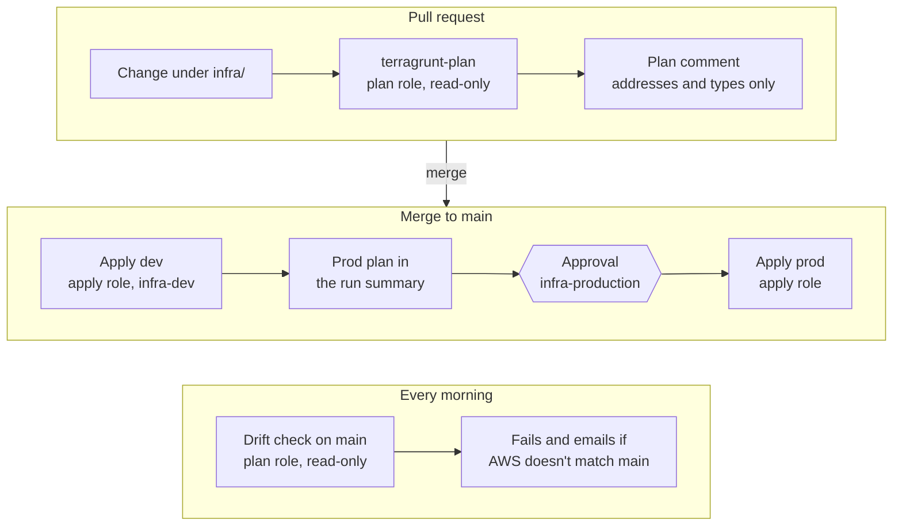

# personal-infra

Personal infrastructure managed with Terragrunt and Terraform:
- **AWS**: my personal AWS account, under `infra/aws/terragrunt`
- **GitHub**: the `amcaughan-personal` org's repositories, rulesets and environments, under [`infra/github/terragrunt`](infra/github/terragrunt/README.md)

Both trees share the same S3 state backend, local Docker tooling, and manual apply process.

Tool versions (Terraform, Terragrunt) are set once in [`.tool-versions`](.tool-versions). The dev container, CI's format check and `root.hcl`'s version constraints all read it, so local runs and CI always use the same versions.
The AWS side defines a small, opinionated baseline focused on:
- account-level security visibility
- high-signal alerts
- cost guardrails

This is just for me personally to manage my AWS account.

What’s in here

- CloudTrail with targeted CloudWatch alarms (root login, IAM changes, trail tampering)
- GuardDuty with optional automated response for EC2 cryptomining
- Account-wide S3 public access block
- Cost controls (Budgets, Cost Anomaly Detection)
- Secure S3 patterns for logs and state
- Terragrunt-based layout for clarity and dependency management
- Every resource tagged with `Repo` and `Stack`, so anything in the console points back to the code that manages it

What’s intentionally not in here

- Automated apply from CI (this core infra repo would need basically full admin, that's too unsafe)
  Changes are applied manually to keep a clear human approval boundary
- Multi-account / Organizations setup (Not trying to create a pile of spaghetti, this is for small use cases)

Usage

This repo is applied manually via Terragrunt. CI is limited to static analysis and security scanning.

Work inside the dev container: in VS Code, *Reopen in Container* (`.devcontainer/`). It's the org's base image ([dev-environment](https://github.com/amcaughan-personal/dev-environment): Ubuntu, AWS CLI, [mise](https://mise.jdx.dev)) plus the Terraform and Terragrunt versions from `.tool-versions`, with `~/.aws` mounted. Without VS Code:

```bash
docker build -f .devcontainer/Dockerfile -t personal-infra-dev .
docker run --rm -it -v "$PWD:/workspace" -v "$HOME/.aws:/home/dev/.aws" personal-infra-dev
```

On a new account, run `scripts/tf-backend-setup.sh` once first: it creates the state bucket (`amcaughan-tf-state-us-east-2`) and the `/infra/alert_email` SSM parameter the alert topics subscribe.

How the org's CI reaches AWS

Project repos plan on pull requests, apply from `main` and check for drift every day. Each step signs in to AWS with GitHub OIDC as a role defined here, so no project can change its own permissions. This repo itself is applied by hand.



A stack whose plan would destroy or replace anything stops the apply; those changes are applied by hand.

| Role | Who can assume it | What it can do |
|---|---|---|
| `github-ci-plan-<repo>` | the repo's pull requests, and jobs on `main` outside any environment (the drift check) | read every resource's configuration and the repo's own state; no data contents or secrets |
| `github-ci-apply-<repo>` | jobs in the repo's `infra-dev` and `infra-production` environments, which allow only `main` | create and change the repo's own resources, never delete; create IAM roles only with the repo's permissions boundary |
| `github-ci-<purpose>-<repo>-<env>` | jobs in one GitHub environment of the repo, e.g. `production` for deploys | one job's permissions, e.g. deploy and invoke one Lambda function, or query the dashboard's tables |

Every project repo has an apply role; a few resources each project's stack lists (e.g. creating functions from an image, or the API's CloudFront distributions and smoke-test canary) are still created by hand. Code deploys (the deploy roles) run on every merge that changes the code, separately from infrastructure.

Everything this repo creates for one project repo lives under `infra/aws/terragrunt/live/repos/<repo>/`, grouped by kind: its CI roles are in `ci-roles/`, one stack per role; the account-wide stacks sit beside it (`identity/`, `security/`, `visibility/`). Each repo gets a read-only plan role (`github-ci-plan-<repo>`, stack `<repo>/ci-roles/plan`) that its pull requests can assume to run Terragrunt plans, as can jobs on main outside any environment (its scheduled drift check). What CI roles can read comes from the `github-ci-read-access` module: every resource's configuration, but not data contents, except that repo's own Terraform state and `/github/<repo>/` SSM parameters plus the shared `/services/` parameters.

A repo whose infra CI applies also gets an apply role (`github-ci-apply-<repo>`, stack `<repo>/ci-roles/apply`; every project repo). Only jobs in its `infra-*` GitHub environments, which allow only main, can assume it. It reads what the plan role reads, writes the repo's state, and may create and change, but not delete, the repo's own resources (scoped by name prefix, or by the `Repo` tag where ARNs carry no name, listed per repo in the stack). Destroys stay local applies. The repo's IAM roles must carry its permissions boundary (`github-ci-boundary-<repo>`), which caps what they can do, and the role can't change the boundary or any `github-ci-*` role or policy, so a CI apply can't grant itself more.

Roles that GitHub deploys assume live here too once a repo's infra is CI-applied, since CI must not be able to change who can assume what. `github-ci-lambda-deploy-role` (stacks `<repo>/deploy-<environment>`) may update one Lambda function's code and invoke it, only from that GitHub environment; it publishes the environment's `DEPLOY_ROLE_ARN` and `FUNCTION_NAME`. `github-ci-environment-role` is the general form: a role one GitHub environment's jobs assume for one job (`purpose`), with the permissions listed in its stack, publishing its ARN and any values the workflow reads (data-simulator-analytics' deploy and dashboard roles).

Role ARNs are published to SSM at `/github/<repo>/PLAN_ROLE_ARN` and `APPLY_ROLE_ARN`, and the GitHub stack turns each into that repo's Actions secret of the same name. Any published value that contains the AWS account ID (role ARNs, ECR URLs) becomes a secret rather than a variable, so GitHub masks it in public workflow logs.

The roles trust GitHub's immutable OIDC subject (`repo:<org>@<org id>/<repo>@<repo id>:...`), so a repo deleted and recreated under the same name doesn't match. The org is opted in to that format with one API call, because the GitHub Terraform provider can't manage it. GitHub requires claim keys with it; `repo` and `context` match its default subject:

```bash
# needs the admin:org scope: gh auth refresh -h github.com -s admin:org
echo '{"use_immutable_subject":true,"include_claim_keys":["repo","context"]}' \
  | gh api -X PUT orgs/amcaughan-personal/actions/oidc/customization/sub --input -
gh api repos/amcaughan-personal/<repo>/actions/oidc/customization/sub --jq .sub_claim_prefix  # check a repo
```

If you copy pieces from this repo, do so deliberately. Most modules are tightly scoped to a single-account context.

License

MIT
